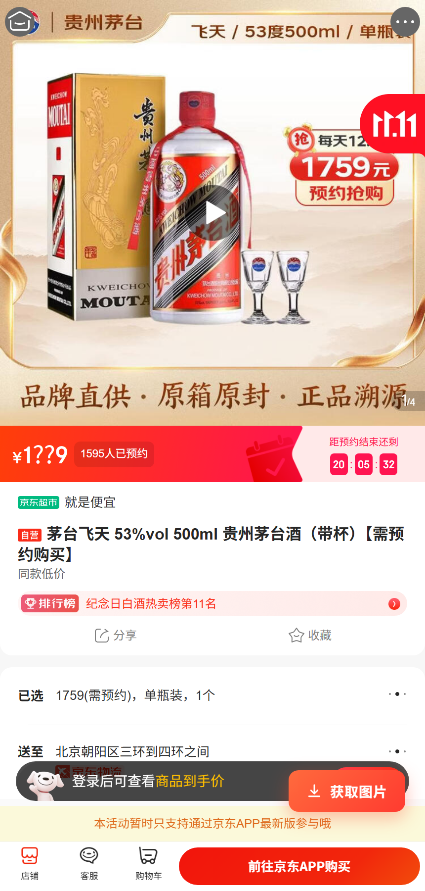
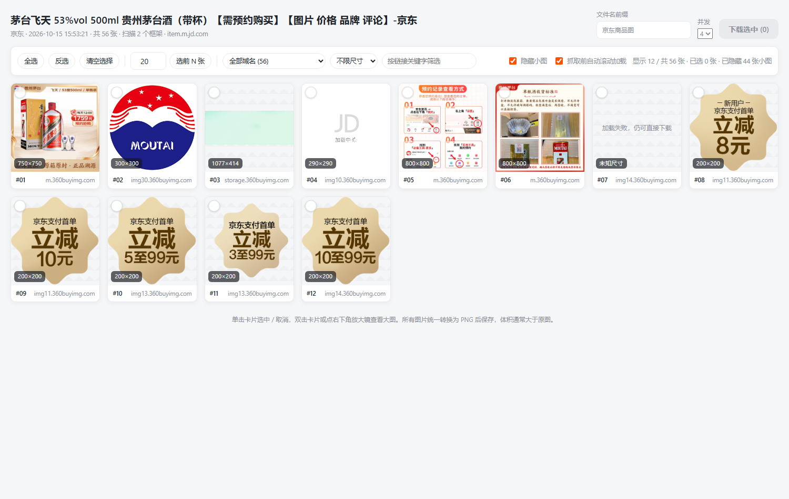
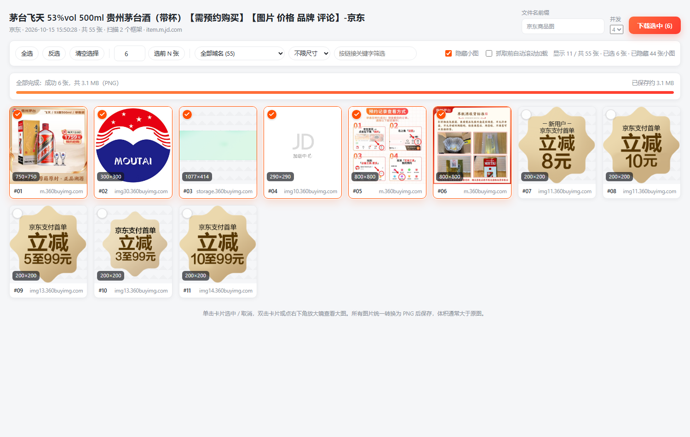

# 电商图片提取下载器

一个 Chrome Manifest V3 扩展：在淘宝 / 天猫、京东、拼多多（含商家版）的商品详情页右下角注入「获取图片」按钮，一键抓取页面上的全部商品图片，在新标签页中网格化展示、勾选，并批量下载为 **PNG** 格式。

## 功能

- **一键抓取**：悬浮按钮位于页面右下角，不遮挡客服/购物车浮层，点击即抓取
- **覆盖全来源**：``（含 `currentSrc`）、`srcset` 最高清项、各类懒加载属性、CSS `background-image`、`<picture>`、图片链接、页面内嵌 JSON 中的图片地址
- **跨 frame 汇总**：详情长图所在的 iframe（含嵌套）会被递归采集并汇总到一次结果里
- **自动还原原图**：剥离各平台的缩略图尺寸后缀，把 `_430x430q90.jpg`、`/n5/jfs/...` 这类地址还原成原图地址
- **清洗去重**：过滤图标/logo/占位图/静态资源；结果页再按图片真实尺寸隐藏角标、按钮这类小图；同图不同尺寸只保留最清晰的一张
- **结果页选择**：单张勾选、全选/反选/清空、选前 N 张、按域名与尺寸筛选、按链接关键字搜索、移除误抓图片
- **预览**：双击卡片或点放大镜查看大图，支持 ← / → 切换、Esc 关闭
- **PNG 批量下载**：并发转换与下载、进度显示、失败项列出原因并可一键重试

## 目录结构

```
ecom-image-grabber/
├── manifest.json                   扩展清单（MV3）
├── assets/icon16|32|48|128.png     扩展图标
├── src/
│   ├── background/
│   │   └── service-worker.js       采集调度：广播采集、汇总清洗去重、存取结果、跨域取图代理
│   ├── content/
│   │   ├── collector.js            页面图片采集器（在页面上下文运行，负责"捞全"）
│   │   └── content.js              内容脚本入口：注入悬浮按钮、响应采集请求、SPA 路由监听
│   ├── gallery/
│   │   ├── gallery.html            结果页骨架
│   │   ├── gallery.css             结果页样式（含深色模式）
│   │   ├── gallery.js              结果页逻辑：渲染、勾选、预览、PNG 批量下载
│   │   └── preview.html            结果页 UI 预览（桩数据，不参与扩展运行）
│   └── shared/
│       ├── platforms.js            平台规则：详情页识别、CDN 白名单、缩略图还原、非商品图过滤
│       ├── url-utils.js            URL 解析/归一化/去重/srcset 择优/尺寸推断
│       ├── image-to-png.js         图片 → PNG 转换（OffscreenCanvas 优先，回退 canvas）
│       └── utils.js                通用工具：并发池、文件名净化、格式化
├── tests/
│   └── pipeline-smoke-test.js      采集流水线冒烟测试（Node 中打桩 chrome API，40 项断言）
└── docs/
    ├── 平台适配规则.md              各平台 URL/CDN/DOM/iframe/坑位对照表与探测脚本
    ├── screenshots/                界面截图（README 引用）
    └── index.html                  产品官网（静态单页）
```

## 安装

1. 打开 `chrome://extensions/`
2. 右上角打开「开发者模式」
3. 点击「加载已解压的扩展程序」，选择本项目根目录 `ecom-image-grabber`
4. 打开任意商品详情页，右下角会出现「获取图片」按钮

## 使用

1. 在详情页点「获取图片」，按钮显示「获取中…」，抓取完成后显示「已获取 N 张」，并自动打开结果页
2. 在结果页勾选需要的图片（单击卡片选中/取消，双击查看大图）
3. 填写文件名前缀（默认取商品标题），点「下载选中 (N)」
4. 文件保存到下载目录的 `电商图片/` 子目录，命名为 `前缀_01.png`、`前缀_02.png`……
5. 关闭结果页后，点扩展工具栏图标可重新打开最近一次抓取结果

> 如果抓到的图偏少：勾选结果页工具栏的「抓取前自动滚动加载」再抓一次，让懒加载的详情长图先进入 DOM。

## 界面预览

以下截图来自**真实运行环境**：本机 Chrome 加载扩展后打开京东商品详情页（`item.m.jd.com/product/100012043978.html`），点击「获取图片」完成采集与下载，未做任何内容伪造。







## 工作原理

```
详情页（顶层 frame）点击按钮
        │
        ▼
Service Worker 向该标签页的所有 frame 广播采集指令
        │
        ├── 顶层 frame 采集主图 / SKU 图 / 背景图 / 内嵌 JSON
        └── iframe（详情长图所在域）各自采集并回传
        │
        ▼
Service Worker 汇总 → 还原原图 → 过滤非商品图 → 归一化去重 → 写入 chrome.storage.session
        │
        ▼
打开 src/gallery/gallery.html 结果页（读取 session storage，渲染网格）
        │
        ▼
勾选后：fetch 原图 → createImageBitmap → canvas 绘制 → toBlob('image/png')
        → chrome.downloads.download(blob URL, '电商图片/前缀_01.png')
```

## 关键技术点

**1. 为什么取图要放在结果页，而不是内容脚本？**
内容脚本发起请求时使用页面自身的源，受同源策略限制——即使扩展声明了 `host_permissions` 也一样。扩展页面（`chrome-extension://`）与 Service Worker 才享有 `host_permissions` 带来的跨域能力，所以跨域取图与 PNG 转换都放在结果页完成，内容脚本只负责读 DOM。

**2. 为什么必须要 `all_frames`？**
淘宝的 `desc.alicdn.com`、京东的 `dx.3.cn` 等详情描述位于 iframe 中，不开启 `all_frames` 会漏掉绝大部分详情长图。

**3. 防盗链兜底**
取图链路是「结果页直连 fetch → 失败则交给 Service Worker 代理 fetch → 仍失败则通过 `declarativeNetRequest` 给该图片域名补 `Referer` 请求头后重试」，三级依次降级。

**4. PNG 体积**
PNG 是无损格式，同一张图转 PNG 后通常比原 JPG/WEBP 大很多（详情长图可能达到十几 MB）。结果页会实时统计已保存体积；如需更小的文件，可将 `image-to-png.js` 中的 `type` 改为 `image/jpeg` 并配合质量参数。

## 权限说明

| 权限 | 用途 |
| --- | --- |
| `downloads` | 保存转换后的 PNG 文件，并跟踪下载是否完成 |
| `storage` | `session` 存放抓取结果并在结果页读取；`local` 保存文件名前缀等设置 |
| `tabs` | 向标签页内所有 frame 广播采集指令、打开结果页、读取来源页标题 |
| `declarativeNetRequestWithHostAccess` | 仅在被拒时给图片域名补 `Referer`，破解防盗链 |
| `host_permissions` | 覆盖三大平台的商品页与图床域名；结果页跨域取图依赖它 |

扩展不采集任何数据，不联网上报，所有处理都在本地浏览器内完成。

## 常见问题

- **按钮没出现**：仅在识别为商品详情页的 URL 上注入（见 `docs/平台适配规则.md` 的匹配规则）；`chrome://`、扩展页等受限页面不会注入。
- **抓到 0 张图**：先勾选「抓取前自动滚动加载」重试；确认图片域名在 `host_permissions` 内（若店铺使用了自有图床，需要把该域名加进 manifest）。
- **图片是模糊缩略图**：说明该平台的还原规则需要补充，请在 `src/shared/platforms.js` 对应平台的 `cleanUrl` 中追加规则，并在 `tests/pipeline-smoke-test.js` 里补一条断言。
- **下载失败（防盗链）**：结果页会列出失败原因，点「重试失败项」会走代理与 Referer 兜底链路。
- **改了代码不生效**：到 `chrome://extensions/` 点击该扩展的刷新按钮；改内容脚本后需要刷新目标页面。

## 已知限制

- 各平台改版（DOM 结构、图片域名、接口）可能导致规则失效，需要同步更新 `platforms.js` 与 `collector.js`
- 部分商详图片地址带时效签名，隔时间过长会失效
- 虚拟列表页面（拼多多商家版部分列表页）只渲染可视区域，需配合自动滚动
- 暂不处理视频、SVG 内嵌图与 canvas 渲染的图
- 单次抓取图片极多（500+）时，PNG 转换会占用较多内存与时间，建议分批下载

## 自测

```bash
node tests/pipeline-smoke-test.js
```

该脚本在 Node 中打桩 `chrome` API 后加载真实的 Service Worker，验证缩略图还原、详情页识别、非商品图过滤、跨 frame 汇总、去重与 session storage 落库等 40 项行为。
